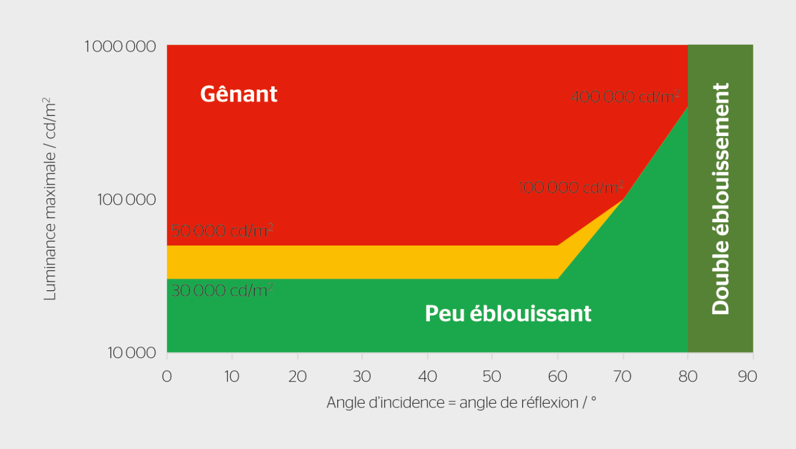

# Projet: Lightworks

*It just works!*

## Membres du groupe

1. Bernasconi Tancredi (BDFL)
2. Andersson Nicolas
3. Diallo Abdoulaye
4. Gonçalves Coelho Vitor José

## Description

### Contexte

Dans le contexte du bâtiment Suisse, la prolifération des modules PV dans le paysage urbain augmente le risque de gêne visuelle issue de la réverbération de la lumière du soleil sur les surfaces vitrées. La législation actuelle n'est pas très précises mais le droit se base actuellement sur des jurisprudences Allemandes qui autorisent un maximum de 30 minutes d'**éblouissement** par jour aggrégé sur l'année avec un principe "premier arrivé-premier servi".
Le principe de précaution étant central dans la confédération, les organes communaux et cantonaux sont très attentifs à éviter tout risque future qui obligeraient à effectuer des modifications tardives des projets de bâtiments.

### Objectif

L'objectif est de créer un mapping de l'intensité d'une source lumineuse sur des bâtiments extraits des couches GIS en Suisse. La surface définie par l'utilisateur sera utilisée comme source lumineuse.

### Délivrable

Le résultat est une carte 3D qui permet d'observer directement la durée d'ensoleillement. Le GUI doit permettre de construire des objets géométriques simples ou de les importer depuis des fichiers usuels de 3D (par exemples .STL ou .obj) et de les placer dans n'importe quelle zone GPS sur le territoire Suisse.

## Liste des tâches / Planification
1. Implémentation du setup des outils IA cohérents pour travail du groupe (skills Matt Pocock)
2. Développement MVP - coordonnées: 46.534729 N, 6.623038 E
   1. GUI
   2. Tests pour vérifier la logique
   3. Décrire les specs et coder l'importation des objets 3D - Définis par l'utilisateur pour la partie réfléchissante
   4. **Rechercher, documenter** les sources et coder l'importation des objets 3D - Importation GIS existant depuis des coordonnées GPS
   5. Intégration 3+4
   6. Logique concernant la réflexion des rayons
3. Debug
4. Généralisation + intégration à toute la Suisse
   1. Définition technologie de ray-tracing / reverse-tracing
   2. Optimisation des performances - refactorisation dans d'autres languages
   3. Analyse du potentiel de portage sur différentes plateformes / création outil en ligne
   4. Intégration des effets de gêne dûs à la luminance
5. Analyse de marché pour acquéreurs potentiels
